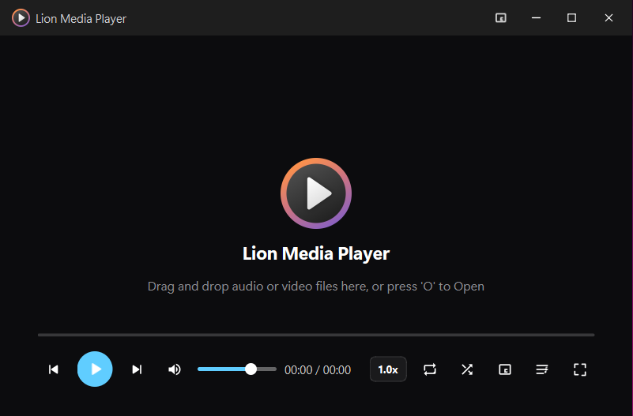

# 🦁 Lion Media Player

A modern, fast, hardware-accelerated desktop media player crafted in **C++20** and **Qt 6**. Built with a sleek dark Fluent Design language, Lion Media Player delivers an immersive viewing experience with custom window framing, translucent floating controls, Picture-in-Picture mode with hold-and-drag screen repositioning, smart playlist queue management, and comprehensive keyboard/mouse shortcuts.

<p align="center">
  
</p>

---

## 📖 Table of Contents

- [User Guide & Features](#-user-guide--features)
  - [Core Playback & Seeking](#core-playback--seeking)
  - [Audio & Volume Control](#audio--volume-control)
  - [Playback Speed & Loops](#playback-speed--loops)
  - [File Opening & Play Queue](#file-opening--play-queue)
  - [Picture-in-Picture (PiP) Mode](#picture-in-picture-pip-mode)
  - [Fullscreen & Floating Overlays](#fullscreen--floating-overlays)
  - [On-Screen Display (OSD) Notifications](#on-screen-display-osd-notifications)
  - [Supported Media Formats](#supported-media-formats)
  - [Keyboard & Mouse Shortcuts Reference](#-keyboard--mouse-shortcuts-reference)
- [Developer Guide & Build Details](#-developer-guide--build-details)
  - [Architecture & Codebase Overview](#architecture--codebase-overview)
  - [Prerequisites & System Requirements](#prerequisites--system-requirements)
  - [Building from Source (Command Line)](#building-from-source-command-line)
  - [Building with Qt Creator](#building-with-qt-creator)
  - [Windows Deployment & Packaging](#windows-deployment--packaging)
  - [Technical Highlights](#technical-highlights)

---

# 🎬 User Guide & Features

### Core Playback & Seeking
- **Instant Play / Pause**: Click anywhere on the video screen, press `Spacebar`, or click the large central play button on the control bar.
- **Precision Interactive Seekbar**: Click or drag along the seekbar to jump instantly to any point in the media.
- **Timestamp Hover Preview**: Move your mouse over the seekbar to view a floating real-time preview bubble showing the exact target timestamp.
- **Keyboard Seeking**:
  - `Left Arrow` / `Right Arrow`: Seek backward / forward by 5 seconds.
  - `Shift + Left Arrow` / `Shift + Right Arrow`: Seek backward / forward by 15 seconds.
- **Track Navigation**:
  - `N`: Next track in queue.
  - `PageUp` or `Shift + P`: Previous track (or restarts track if past 3 seconds).

### Audio & Volume Control
- **Interactive Volume Slider**: Fine-tune volume with the slider on the control bar.
- **Scroll Wheel Volume**: Place the cursor over the video and scroll your mouse wheel up or down to adjust volume in 5% steps.
- **Arrow Keys**: Press `Up Arrow` (+5%) or `Down Arrow` (-5%) at any time to adjust volume.
- **One-Key Mute**: Press `M` or click the speaker icon to instantly mute/unmute audio.

### Playback Speed & Loops
- **Speed Presets**: Click the speed badge (`1.0x`) on the control bar to choose from speed presets (`0.5x`, `0.75x`, `1.0x Normal`, `1.25x`, `1.5x`, `2.0x`).
- **Granular Speed Shortcuts**: Press `[` to slow down by -0.25x or `]` to speed up by +0.25x.
- **Loop Modes**: Press `L` or click the Loop icon to cycle between:
  - **Loop Off**: Plays queue once and pauses upon completion.
  - **Loop All**: Cycles through the entire queue indefinitely.
  - **Loop Current**: Repeats the active media file continuously.
- **Shuffle Mode**: Press `S` or click the Shuffle icon to randomize queue playback order.

### File Opening & Play Queue
- **Normal Open (`O`)**:
  - Press `O` or drop files onto the video screen to open media.
  - Clears the previous queue, loads the selected file(s), and starts playback immediately.
  - Remembers the **last opened file directory** across application restarts.
- **Add to Queue (`Ctrl + O` or `+` Button)**:
  - Press `Ctrl + O`, click the `+` button in the Play Queue drawer, or drop files directly into the drawer to add files to the playlist.
  - Appends new items to the queue **without interrupting** current playback.
- **Duplicate Prevention**:
  - Automatically identifies identical files by path/URL and ignores duplicates so your queue remains clean and organized.
- **Play Queue Drawer (`Ctrl + Q`)**:
  - Toggle the right-hand slide-out drawer via `Ctrl + Q` or the queue icon.
  - View total track count, ordered list with filenames and duration tags.
  - Double-click any track to jump straight to it.
  - Right-click any track for context actions: *Play Track*, *Remove from Queue*, or *Show in File Explorer*.
  - Trash icon to clear the queue with a single click.

### Picture-in-Picture (PiP) Mode
- **Instant PiP Toggle (`P`)**: Press `P` or click the PiP button in the title bar or control bar to detach into an always-on-top compact window (`420x236`).
- **Hold & Drag Window Repositioning**:
  - Click and hold the left mouse button anywhere on the PiP player (video area or control bar) and drag to move the player freely across any monitor or desktop.
  - The cursor switches to a closed hand grab icon (`Qt::ClosedHandCursor`) during dragging.
  - Releasing after dragging will not trigger an accidental play/pause toggle.
- **Seamless Translucent Controls**: Sliders and buttons render transparently with no dark bounding boxes below the track.
- **Exit PiP**: Press `P`, `Esc`, or click the PiP button to restore the player to its previous window size and position.

### Fullscreen & Floating Overlays
- **Toggle Fullscreen (`F` or Double-Click)**: Enter a distraction-free, edge-to-edge viewing mode. Press `Esc` or `F` to return.
- **Auto-Hiding Controls**: When playing, the floating control bar smoothly fades out after 2.5 seconds of mouse inactivity, and the mouse cursor hides in fullscreen for a true cinematic experience. Moving the mouse wakes the controls immediately.

### On-Screen Display (OSD) Notifications
- Unobtrusive, animated notifications appear in the upper-right corner providing instant feedback for volume changes, seek deltas, playback rate, loop/shuffle toggles, track titles, and errors.

### Supported Media Formats
- **Video Containers & Codecs**: MP4, MKV, AVI, WEBM, FLV, MOV, M4V.
- **Audio Formats**: MP3, WAV, AAC, OGG, FLAC.
- Powered by Qt 6 Multimedia with the FFmpeg backend for wide codec support.

---

## ⌨ Keyboard & Mouse Shortcuts Reference

| Shortcut | Action | Description |
| :--- | :--- | :--- |
| `Space` | Play / Pause | Toggles playback state |
| `Left Arrow` | Seek -5s | Skip backward by 5 seconds |
| `Right Arrow` | Seek +5s | Skip forward by 5 seconds |
| `Shift + Left` | Seek -15s | Skip backward by 15 seconds |
| `Shift + Right` | Seek +15s | Skip forward by 15 seconds |
| `Up Arrow` | Volume Up | Increase audio volume by 5% |
| `Down Arrow` | Volume Down | Decrease audio volume by 5% |
| `Mouse Scroll` | Volume Adjust | Scroll up/down anywhere on the video area |
| `M` | Mute / Unmute | Toggles audio mute state |
| `O` | Open Media | Opens file dialog in last directory & plays immediately |
| `Ctrl + O` | Add to Queue | Opens file dialog to append media to queue without stopping |
| `P` | Toggle PiP | Enter or exit Picture-in-Picture always-on-top mode |
| `Left Drag (PiP)` | Move Window | Click, hold, and drag player around the screen in PiP mode |
| `F` | Fullscreen | Toggle fullscreen mode |
| `Double Click` | Fullscreen | Toggle fullscreen mode |
| `Esc` | Exit / Close | Exit fullscreen, exit PiP, or close playlist drawer |
| `Ctrl + Q` | Play Queue | Open or close the playlist drawer |
| `N` | Next Track | Advance to next item in the queue |
| `PageUp` / `Shift+P`| Previous Track | Play previous item (or restart track if > 3s) |
| `L` | Loop Mode | Cycle loop modes: None ➔ All ➔ Current Track |
| `S` | Shuffle | Toggle randomized queue playback order |
| `[` | Speed -0.25x | Decrement playback rate (minimum 0.5x) |
| `]` | Speed +0.25x | Increment playback rate (maximum 2.0x) |

---

# 🛠 Developer Guide & Build Details

### Architecture & Codebase Overview

Lion Media Player is organized into distinct, modular subsystems separating core playback logic, custom UI controls, and utility services:

```
c:\dev\LionVideo\
├── CMakeLists.txt              # Primary CMake project configuration
├── main.cpp                    # Application bootstrap & FFmpeg backend setup
├── README.md                   # Project documentation & user/dev guide
├── resources/
│   ├── app.png                 # Application UI demonstration screenshot
│   ├── app.rc                  # Windows application resource file (icon & metadata)
│   ├── player.ico              # Multi-resolution Windows app icon
│   ├── player.png              # High-resolution PNG app icon
│   ├── player.webp             # Compressed WebP branding asset
│   ├── resources.qrc           # Qt resource bundle descriptor
│   └── icons/                  # 23 customized Fluent SVG icons
└── src/
    ├── core/
    │   ├── MediaPlayerEngine.h   # Playback engine controller
    │   └── MediaPlayerEngine.cpp # QMediaPlayer / QAudioOutput management & queue logic
    ├── ui/
    │   ├── MainWindow.h          # Main frameless container & overlay manager
    │   ├── MainWindow.cpp        # Global event filtering, shortcut routing, PiP logic
    │   ├── VideoWidget.h         # QGraphicsView hosting QGraphicsVideoItem
    │   ├── VideoWidget.cpp       # Aspect ratio scaling & PiP drag handler
    │   ├── ControlBar.h          # Floating translucent glass HUD
    │   ├── ControlBar.cpp        # Responsive playback controls & PiP dragging
    │   ├── ClickableSlider.h     # Custom antialiased seekbar
    │   ├── ClickableSlider.cpp   # Hover ghosting & time preview bubble
    │   ├── PlaylistDrawer.h      # Right-side slide-out playlist drawer
    │   ├── PlaylistDrawer.cpp    # Queue list widget, context menu & drop target
    │   ├── TitleBar.h            # Frameless title bar with minimize/maximize/close
    │   ├── TitleBar.cpp          # Windows window dragging & window controls
    │   ├── OSDLabel.h            # Animated floating notification banner
    │   └── OSDLabel.cpp          # Toast animations with QGraphicsOpacityEffect
    └── utils/
        ├── IconHelper.h          # SVG colorizing and QIcon cache
        ├── IconHelper.cpp        # High-DPI icon rasterizer
        ├── StyleManager.h        # Dark theme stylesheet generator
        ├── StyleManager.cpp      # Fluent Design QSS definitions
        ├── TimeFormatter.h       # Time string formatting
        └── TimeFormatter.cpp     # Formats milliseconds into mm:ss / hh:mm:ss
```

#### Key Architecture Highlights
- **Engine Subsystem (`core::MediaPlayerEngine`)**: Encapsulates `QMediaPlayer` and `QAudioOutput`. Maintains the playlist vector, handles track index state, manages duplicate elimination using canonical path comparison (`QDir::cleanPath`), and implements shuffle sequencing.
- **Event Filtering & Focus Isolation (`ui::MainWindow`)**: Employs an application-level event filter on `qApp` to intercept key combinations (`Space`, `Arrows`, `O`, `P`, `Esc`) before child widgets can consume them, while respecting active modal dialogs (`QFileDialog`) and popup menus.
- **Adaptive Floating Overlays**: `ControlBar`, `PlaylistDrawer`, and `OSDLabel` are children of `VideoWidget`, raised above the video scene. In PiP mode, secondary controls automatically collapse to ensure the volume seekbar and playback buttons fit cleanly without clipping.
- **Hardware-Accelerated Video Rendering**: Utilizes `QGraphicsVideoItem` rendered within an antialiased `QGraphicsView` for smooth letterboxed video scaling (`Qt::KeepAspectRatio`).

---

### Prerequisites & System Requirements

| Dependency | Minimum Version | Recommended | Notes |
| :--- | :--- | :--- | :--- |
| **OS** | Windows 10 (64-bit) | Windows 11 (64-bit) | Linux & macOS compatible with minor adjustments |
| **Compiler** | C++20 capable | LLVM Clang 17+ or GCC 11+ or MSVC 2022 | Must support C++20 standard |
| **CMake** | 3.20 | 3.28+ | Build system generator |
| **Build Tool** | Ninja 1.10+ | Ninja 1.12+ | High-speed parallel builds |
| **Qt Framework** | Qt 6.5.0 | Qt 6.8+ or Qt 6.12+ | Modules: `Widgets`, `Multimedia`, `MultimediaWidgets`, `Svg` |
| **Multimedia Backend** | FFmpeg | Built-in Qt FFmpeg plugin | Configured automatically via environment flags |

---

### Building from Source (Command Line)

#### 1. Open Terminal
Open **PowerShell** or **Command Prompt** with the compiler environment initialized (e.g. LLVM MinGW or MSVC vcvars64).

#### 2. Configure the Project
Create the build directory and run CMake:
```powershell
cmake -B build -G Ninja -DCMAKE_BUILD_TYPE=Release
```

> [!TIP]
> If Qt is installed in a non-standard path, specify `CMAKE_PREFIX_PATH`:
> ```powershell
> cmake -B build -G Ninja -DCMAKE_BUILD_TYPE=Release -DCMAKE_PREFIX_PATH="C:/Qt/6.12.0/llvm-mingw_64"
> ```

#### 3. Compile the Executable
Execute the build with Ninja:
```powershell
cmake --build build --config Release
```

The compiled binary will be placed at:
```
build/LionVideo.exe
```

---

### Building with Qt Creator

1. Open **Qt Creator**.
2. Select **File ➔ Open File or Project...** and choose `c:\dev\LionVideo\CMakeLists.txt`.
3. Select your installed **Qt 6 Desktop Kit** (e.g. *Desktop Qt 6.12.0 LLVM-MinGW 64-bit*).
4. Click **Configure Project**.
5. Build and run using `Ctrl + R` or click the green **Run** button.

---

### Windows Deployment & Packaging

To run the application standalone on machines without Qt installed:

1. Locate the built `LionVideo.exe` in your Release build directory.
2. Run `windeployqt` to copy all required Qt DLLs and plugins:
```powershell
windeployqt --release --qmldir . build/LionVideo.exe
```
3. Ensure the following multimedia and SVG plugins are present in the folder:
   - `multimedia/`
   - `iconengines/`
   - `imageformats/`
   - `platforms/qwindows.dll`

---

### Technical Highlights

- **Frameless Window with Native Snapping**: On Windows, `MainWindow::nativeEvent` processes `WM_NCHITTEST` messages, allowing true native edge/corner resizing, Aero Snap window docking, and smooth window gestures without native OS title bars.
- **Transparent Control Styling (`WA_TranslucentBackground`)**: Custom sliders (`ClickableSlider` and `QSlider`) and `ControlBar` apply `Qt::WA_TranslucentBackground` and `Qt::WA_NoSystemBackground` alongside custom QSS so rounded borders and slider tracks float gracefully over video frames with zero black bounding boxes.
- **Robust Audio Output Routing**: `MediaPlayerEngine` synchronizes `QAudioOutput` with volume clamp boundaries `[0, 100]`, non-linear scaling, and automatic unmuting upon slider interaction.
- **Path Canonicalization**: Queue deduplication utilizes `QDir::cleanPath` with case-insensitive matching to prevent identical files on Windows from entering the queue under alternate drive letter casings or separator styles.

---

## 📄 License

Lion Media Player is open source software. Built for modern desktop performance and multimedia clarity.
